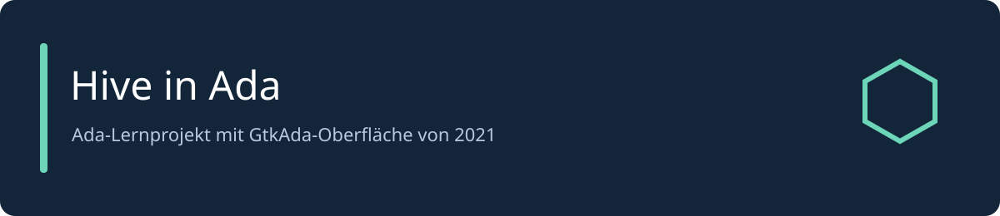

# Hive in Ada



Lernprojekt von 2021 zur Umsetzung des Brettspiels Hive in Ada mit einer GtkAda-Oberfläche.
Der vorhandene Quellstand ist öffentlich gesichert. Eine vollständige Prüfung der Spielregeln ist nicht erfolgt.

[Projektstruktur](#projektstruktur) · [Entwicklung](#entwicklung) · [CI](docs/CI_CD.md) · [Mitmachen](CONTRIBUTING.md) · [Sicherheit](SECURITY.md)

## Enthaltener Stand

- Ada-Modelle und Controller für Spielbrett, Steine und Spielzüge.
- Oberfläche in `Hive_Workspace/src/View/Hive.glade` und PNG-Spielressourcen.
- GPR-Projekt für GNAT/GtkAda und ursprüngliche Grafik-Arbeitsdateien.

## Installation und Quick Start

Windows mit GNAT, GPRbuild und GtkAda verwenden. Lokal wurde der Stand am 7. Oktober 2026
mit der vorhandenen GNAT-Community-/GtkAda-Installation von 2021 erfolgreich kompiliert.
`gprbuild` und die GtkAda-Laufzeit müssen im Prozess-PATH liegen; `GPR_PROJECT_PATH` muss auf das
Verzeichnis mit der echten `gtkada.gpr` zeigen. Die Windows-Pfade im Quellcode setzen Windows voraus.

```powershell
git clone https://github.com/adrianweidig/hive.git
cd hive/Hive_Workspace
gprbuild -p -P hive.gpr mainhive.adb
./obj/mainhive.exe
```

Aus `Hive_Workspace` starten, damit die relativen Pfade zur Glade-Datei und den Ressourcen stimmen.
Es gibt keine separate Konfigurationsdatei; Ressourcenpfade sind im vorhandenen Quellcode hinterlegt.
Der Menüpunkt zum Öffnen der Anleitung erwartet lokal `Dokumente/Hive_Brettspiel_Anleitung.pdf`.
Diese fremde Spielanleitung ist wegen des Copyright-Vermerks nicht in diesem Repository enthalten.

## Projektstruktur

| Pfad | Inhalt |
| --- | --- |
| `Hive_Workspace/hive.gpr` | GNAT-Projekt |
| `Hive_Workspace/src/Controller` | Bedienung und Initialisierung |
| `Hive_Workspace/src/Model` | Spielzustand und Spielzüge |
| `Hive_Workspace/src/View` | Glade-Oberfläche |
| `Hive_Workspace/resource` | Spielgrafiken und Grafik-Arbeitsdateien |
| `tools/check_project.py` | Integritätsprüfung |

## Entwicklung

```powershell
python tools/check_project.py
cd Hive_Workspace
gprbuild -p -P hive.gpr mainhive.adb
```

CI prüft Quellstruktur, Glade-XML und PNG-Ressourcen. Der vorhandene `testmanager.adb`
ist ein leerer Einstieg und wird nicht als Testabdeckung ausgewiesen. Automatisierte Spieltests,
Linting und ein Laufzeittest der grafischen Oberfläche sind nicht eingerichtet.
Kompilate und Editor-Sicherungen werden nicht versioniert.

## Automatisierung und Mitarbeit

Jeder Push auf `main` oder `master` erzeugt ein [Commit-ZIP mit Notizen](docs/RELEASE_PROCESS.md).
Docker oder GHCR gehören nicht zu diesem Projekt. Fehler und gezielte Verbesserungen können
über Issues und Pull Requests vorgeschlagen werden; siehe [CONTRIBUTING.md](CONTRIBUTING.md) und [SUPPORT.md](SUPPORT.md).

## Lizenz und Herkunft

Eine Nutzungslizenz ist nicht ausgewiesen. Hive und die zugehörigen Spielmarken gehören ihren Rechteinhabern.
Die [Maintainer-Checkliste](docs/MAINTAINER_CHECKLIST.md) erfasst Lizenz- und Rechteentscheidungen.
Nachvollziehbare Korrekturen am vorhandenen Lernstand sind willkommen.
